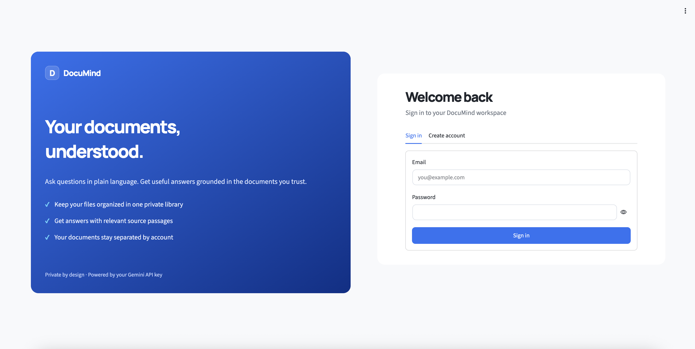
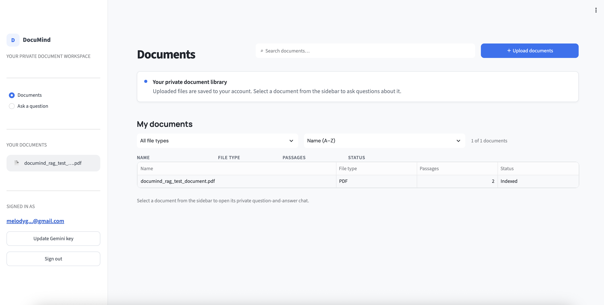

# DocuMind RAG

A private document question-answering workspace using FastAPI, Streamlit, Gemini, and FAISS.


## UI



## Features

- Create an account and sign in with an email address and password
- Stay signed in across browser refreshes with a 30-day session cookie; the app waits for the browser cookie to load before showing the sign-in page
- Save a Gemini API key to your account; it is encrypted at rest and restored after sign-in or refresh
- Upload PDF, Word (.docx), TXT, and Markdown documents
- Keep uploaded files and their search indexes isolated by account
- View the saved document library in the sidebar and ask questions about one selected file
- Delete uploaded documents and remove their original files and indexed passages
- Search, filter, and sort documents from a table-style account dashboard
- Extract and chunk document text
- Create Gemini embeddings and store them in a local FAISS index
- Retrieve relevant passages for a question
- Generate grounded answers with Gemini and display retrieved source passages
- REST API documentation at `/docs`

## 1. Install dependencies

Python 3.11 or 3.12 is recommended.

```bash
python -m venv .venv
source .venv/bin/activate
python -m pip install --upgrade pip
pip install -r requirements.txt
```

Optionally copy `.env.example` to `.env` to customize the model, upload limit, or data directory. A Gemini key is not needed in `.env`.

## 2. Run the backend

From the repository root, in Terminal 1:

```bash
uvicorn app.main:app --reload --host 0.0.0.0 --port 8000
```

Open port 8000 from the Codespaces **Ports** tab. Check `/health` and `/docs`.

## 3. Run the frontend

Open a second terminal, activate the environment again, and run:

```bash
source .venv/bin/activate
streamlit run frontend/app.py --server.address 0.0.0.0 --server.port 8501
```

Open port 8501 from the **Ports** tab. Create an account, add a Gemini key, and upload documents to your library.

The frontend expects the API at `http://127.0.0.1:8000` by default. Since both processes run in the same Codespace, this is correct. Do not use the browser's forwarded URL as `API_URL` for this local two-process setup.

## 4. Test

Run unit tests:

```bash
pytest -q
```

The API exposes `/auth/register`, `/auth/login`, and `/auth/me` for account access. Document list, upload, delete, and chat endpoints require the signed-in account's bearer token; indexing and chat also require `X-Gemini-API-Key`. The `/chat` endpoint accepts an optional `document_id` to restrict retrieval to one uploaded document. Use the Streamlit interface or `/docs` to explore the authenticated endpoints.

## Project layout

```text
documind-rag/
├── app/
│   ├── main.py
│   ├── config.py
│   ├── api/
│   └── services/
│       ├── accounts.py
│       ├── document_loader.py
│       └── rag.py
├── frontend/
│   └── app.py
├── tests/
│   ├── test_accounts.py
│   ├── test_api_auth.py
│   ├── test_document_loader.py
│   └── test_rag_accounts.py
├── data/                 # created at runtime; ignored by Git
├── requirements.txt
├── .env.example
├── .gitignore
├── Dockerfile
└── README.md
```

## Notes and limitations

- This starter handles text-based PDFs. Scanned/image-only PDFs need OCR.
- Accounts and login sessions are stored in `data/accounts.sqlite3`. Uploaded document files, chunk metadata, and FAISS indexes are stored beneath `data/users/` in per-account folders (not as blobs in SQLite). The sidebar library is rebuilt from each account's persisted index metadata on login. Deleting the Codespace or its storage may remove this information; use persistent storage and backups for long-term deployments.
- Passwords are stored as salted scrypt hashes. A 30-day browser cookie remembers the server login session across refreshes; signing out revokes the session and removes the cookie. Gemini API keys are encrypted with Fernet before being stored in the account database. By default, the encryption key is generated in the data directory as `.gemini-key-encryption` with owner-only file permissions. Back up this file together with `accounts.sqlite3`; losing it makes saved Gemini keys unrecoverable. For deployments, set `GEMINI_KEY_ENCRYPTION_KEY` to a securely managed Fernet key and back it up separately from the database.
- Gemini API usage may be subject to quotas, pricing, and model availability.
- This is a development starter, not a production-hardened service. Before public deployment, configure trusted CORS origins, HTTPS, rate limits, upload scanning, and persistent backups.
- If you change the embedding model or embedding dimensions, clear the `data/` folder and re-upload documents.
