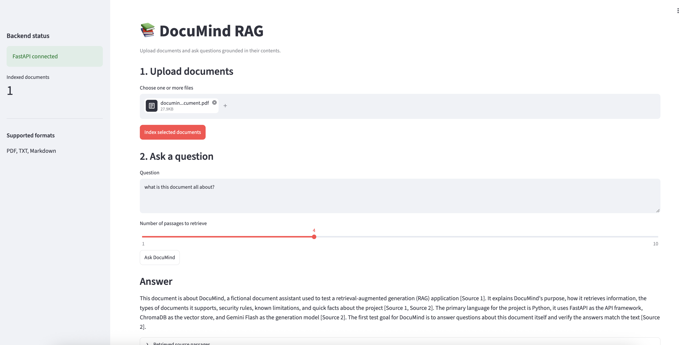

# DocuMind RAG

A beginner-friendly Retrieval-Augmented Generation app using FastAPI, Streamlit, Gemini, and FAISS.


## UI


## Features

- Upload PDF, TXT, and Markdown documents
- Extract and chunk document text
- Create Gemini embeddings and store them in a local FAISS index
- Retrieve relevant passages for a question
- Generate grounded answers with Gemini and display retrieved source passages
- REST API documentation at `/docs`

## 1. Create a Gemini API key

Create an API key in [Google AI Studio](https://aistudio.google.com/app/apikey). Keep it private.

## 2. Configure environment variables

Copy `.env.example` to `.env` and replace the placeholder with your key:

```bash
cp .env.example .env
```

Edit `.env` and set `GEMINI_API_KEY=...`. Never commit `.env` to GitHub.

## 3. Install dependencies in GitHub Codespaces

Python 3.11 or 3.12 is recommended.

```bash
python -m venv .venv
source .venv/bin/activate
python -m pip install --upgrade pip
pip install -r requirements.txt
```

If the environment uses a different Python version, select Python 3.12 or use a Codespaces base image that includes it.

## 4. Run the backend

From the repository root, in Terminal 1:

```bash
uvicorn app.main:app --reload --host 0.0.0.0 --port 8000
```

Open port 8000 from the Codespaces **Ports** tab. Check `/health` and `/docs`.

## 5. Run the frontend

Open a second terminal, activate the environment again, and run:

```bash
source .venv/bin/activate
streamlit run frontend/app.py --server.address 0.0.0.0 --server.port 8501
```

Open port 8501 from the **Ports** tab. Use the Streamlit interface to upload a document and ask a question.

The frontend expects the API at `http://127.0.0.1:8000` by default. Since both processes run in the same Codespace, this is correct. Do not use the browser's forwarded URL as `API_URL` for this local two-process setup.

## 6. Test

Run unit tests:

```bash
pytest -q
```

Check the API:

```bash
curl http://127.0.0.1:8000/health
curl http://127.0.0.1:8000/documents
```

Example chat request after uploading a document:

```bash
curl -X POST http://127.0.0.1:8000/chat \
  -H "Content-Type: application/json" \
  -d '{"question":"Summarize the main points","top_k":4}'
```

## Project layout

```text
documind-rag/
├── app/
│   ├── main.py
│   ├── config.py
│   ├── api/
│   └── services/
│       ├── document_loader.py
│       └── rag.py
├── frontend/
│   └── app.py
├── tests/
│   └── test_document_loader.py
├── data/                 # created at runtime; ignored by Git
├── requirements.txt
├── .env.example
├── .gitignore
├── Dockerfile
└── README.md
```

## Notes and limitations

- This starter handles text-based PDFs. Scanned/image-only PDFs need OCR.
- Local index files are stored in `data/`; deleting the Codespace or its storage may remove them. Back them up or use persistent storage for long-term use.
- Gemini API usage may be subject to quotas, pricing, and model availability.
- This is a development starter, not a production-hardened service. Before public deployment, add authentication, stricter CORS rules, rate limits, upload scanning, and per-user document isolation.
- If you change the embedding model or embedding dimensions, clear the `data/` folder and re-upload documents.
